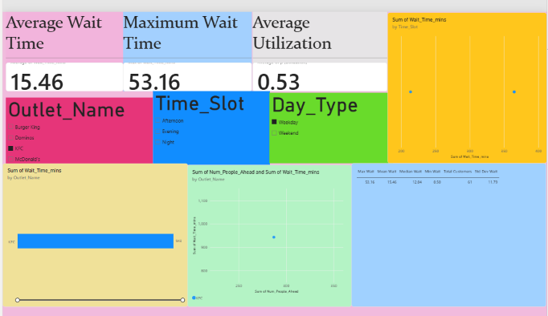

# 🏬 Viviana Mall Food Court Queue Optimization

An end-to-end Data Analytics project using Advanced Excel, R, and Power BI to identify bottlenecks in a food court queueing system, fit stochastic distributions, and mathematically optimize the number of servers.

## 📌 Project Overview
This project analyzes 500 customer observations across 4 major food court outlets (McDonald's, KFC, Dominos, and Burger King) to determine the statistical bottleneck and recommend operational improvements. It combines descriptive statistics, hypothesis testing, stochastic modeling (Queueing Theory), and interactive Business Intelligence.

## 🛠️ Tech Stack
*   **Advanced Excel:** Data cleaning, Descriptive Statistics, Pivot Tables, Heatmaps, Goal Seek, What-If Analysis.
*   **R:** Chi-Square Goodness-of-Fit, Z-Tests, ANOVA with Tukey HSD, Erlang vs. Exponential distribution fitting.
*   **Power BI:** Interactive dashboard, DAX Measures, KPI Cards, Slicers.

## 📊 Methodology & Key Findings

### 1. Data Analysis & EDA (Excel)
*   Collected 500 observations across 4 outlets, focusing on Arrival Time, Service Time, Wait Time, and Queue Length.
*   **Key Finding:** Dominos is the critical bottleneck, with an average wait time of **64 minutes on weekends**. The average utilization (ρ) for Dominos was **0.69**, approaching instability.

### 2. Statistical Testing & Stochastic Modeling (R)
*   **Chi-Square GOF:** Confirmed customer arrivals follow a **Poisson Process** (p > 0.05 for 3 out of 4 outlets).
*   **Inferential Testing:** ANOVA (p < 0.05) and Two-Sample Z-Tests (p < 0.05) proved Dominos is statistically significantly slower than McDonald's.
*   **Erlang Distribution:** Fitted Exponential vs. **Erlangian distributions** to service times. The Erlang fit was significantly better (AIC: 2048 vs 2779, Shape **k=9**), proving food service is a **9-stage process**.

### 3. Optimization & Dashboard (Excel + Power BI)
*   **Queueing Theory (M/E_9/c):** Modeled the food court as a multi-stage queue.
*   **Goal Seek:** Proved that increasing Dominos' servers from 2 to 3 reduces the average wait from **9.09 mins to 1.3 mins**, while dropping utilization from **69% to 46%**.
*   **Power BI Dashboard:** Built an interactive dashboard with dynamic DAX measures that allows users to filter by Outlet, Day Type, and Time Slot to instantly see live descriptive statistics.

## 📂 Repository Contents
*   `viviana_mall_analysis.xlsx`: Master Excel workbook (Data, Descriptives, Queueing Params, Pivot Tables).
*   `statistical_analysis.R`: R script containing all hypothesis testing and distribution fitting.
*   `viviana_mall_dashboard.pbix`: Interactive Power BI dashboard file.
*   `dashboard_preview.png`: Screenshot of the Power BI dashboard.
*   `generate_synthetic_data.py`: Python script used to simulate the 500-observation dataset.